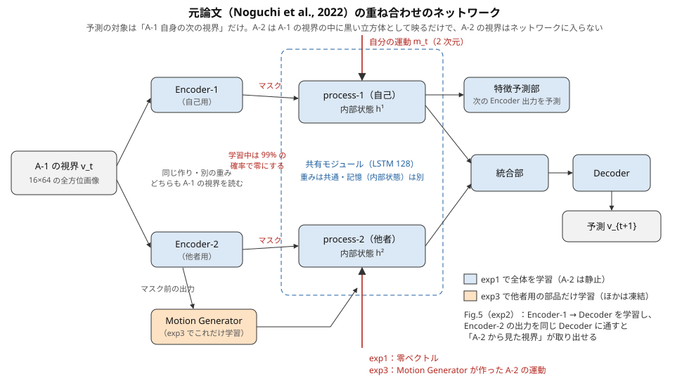
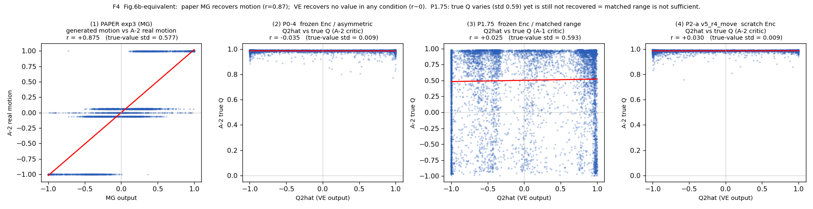
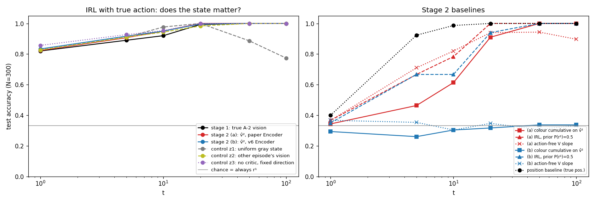
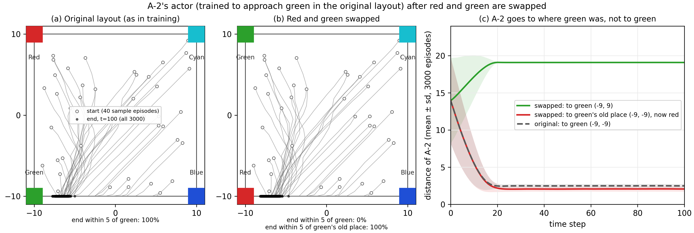
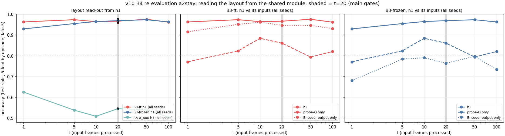
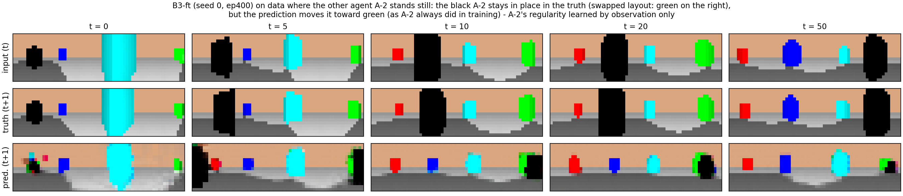

# 修士研究の全体のまとめ：自分の価値の経験から、他者の好みが分かるようになるか

- 作成：2026-10-22。同日、v12 の完成版のまとめ（`docs/v12_summary.md`）に合わせて更新。修論の執筆の土台にする文書。**新しい学習・評価は一切行わず、既にある文書と結果だけから書いた。**
- 文章の正はこのファイル（`docs/research_overview.md`）。`docs/research_overview.html` はこのファイルから `analyze/build_research_overview_html.py` で生成したもので、手では書いていない。
- 各版の詳しい数値・経緯は、各版のまとめの文書（末尾の「付録 1」）を正とする。この文書の数値は、主の基準と判定に絞った。
- 書き方の約束：**事実**（測った結果）と **解釈（推測）**（理由の読み）を分けて書く。推測には必ず「推測」と書く。専門の言葉は「G. 用語集」に一行ずつ説明を置いた。
- パスは `my_research/preference_inference/` からの相対パス。図は本文の中に置き、一覧は「F. 図の一覧」にまとめた。v10 の後半の図（B4・再評価）は v10 の作業ツリーにだけあるので、本文に載せる 2 枚を `docs/figs/` にコピーし、そこから読む（コピー元は F に記す）。

---

## A. 研究の問いと背景

### 問い

**自分が好みに従って動いた経験があると、他者の動きを見て、他者の好み（価値）が分かるようになるか。** 最低限、他者の好みが「場所」ではなく「物（色）」に結びついて表れることを求める。

### 発達研究との対応

- **Woodward (1998)**：乳児は、手が二つの物のうち一方をつかむ場面をくり返し見たあと、二つの物の置き場所を入れ替えると、「同じ場所の別の物」に手が伸びたときの方を長く見る。乳児は他者の行為の目標を、場所ではなく物として捉えている。
- **Sommerville, Woodward & Needham (2005)**：まだ自分で物をつかめない月齢の乳児に、物をつかめる経験（物がくっつくミトン）をさせると、他者の手の目標を物として捉えるようになる。**自分の行為の経験が、他者の目標の理解を生む。**
- 本研究との対応：物＝ランドマークの「色」、置き場所＝「場所」、置き場所の入れ替え＝赤と緑の入れ替え（v10 以降の環境）、自分でつかむ経験＝「経験あり」の条件（A-1 が半分は好きな色の方へ動く。v11・v12）。v11・v12 の 2 段目の主の見分け T2（入れ替えの瞬間）は、Woodward の入れ替えの課題に当たる。
- （文献の細部は、修論の執筆の際に原典で確かめること。この文書では指示書 `docs/v11_instructions_1_v2.md` §2.1 の対応づけに従った。）

### 元論文と本研究の位置づけ

- **元論文**（Noguchi, Iizuka, Yamamoto & Taguchi, 2022, *Scientific Reports* 12:2859）は、一つの LSTM（共有モジュール）の中に「自分を表す処理（process-1）」と「他者を表す処理（process-2）」を重ねて持たせ、**自分の次の視界を予測する学習だけで**、他者の位置・他者から見た視界（Fig.5）・他者の運動（Fig.6）の表現が生まれることを示した。元論文の限界は「他者の内面（意図・価値）には届いていない」こと。
- **本研究**は、この重ね合わせの仕組みを「**他者の運動**」から「**他者の価値（好み）**」へ広げられるかを問う。自分の価値の扱い方（どちらが快いか、快い方へ動くこと）を予測学習の中で身につけ、それを同じ共有モジュールで他者にも当てはめれば、他者の好みが表れるはずだ、という考え方である。
- v4〜v7 は「外から与えた価値（強化学習の critic）」を入力にする路線、v10 は価値と色の結びつきの確認、v11・v12 は「ネットワーク自身が自分の経験から価値と行動の結びつきを作る」路線である。

---

## B. 元論文の仕組み

### 入力と部品

- **入力**：A-1 の全方位の視界（16×64 の画像）と、A-1 自身の運動 m_t（2 次元）。A-2 は A-1 の視界の中に黒い立方体として映るだけで、A-2 の視界はネットワークに入らない。
- **Encoder-1・Encoder-2**：同じ作り・別の重みで、**どちらも A-1 の視界**を読む。学習中は出力を 99% の確率で零にする（視覚がない間も運動を積み上げて位置を追うことを学ばせるため）。
- **共有モジュール**（LSTM、128 ユニット）：process-1（自己）と process-2（他者）で**重みを共有し、記憶（内部状態 h¹・h²）は別**に持つ。process-1 には自分の運動、process-2 には零ベクトル（exp1）を入れる。
- **統合部・Decoder**：h¹ と h² をまとめて、A-1 の次の視界を出す。**特徴予測部**は h¹・h² から次の Encoder 出力を予測する枝。
- **Motion Generator（MG）**：exp3 で足す他者用の部品。マスク前の Encoder-2 の出力を読み、A-2 の運動を作って process-2 に入れる。

### 学習の手順

| 段 | 元論文の名前 | データ | 学習するもの |
|---|---|---|---|
| 1 段目 | exp1（mse 段 200 エポック → l1 段 200 エポック） | A-1 はランダムに歩く、A-2 は静止（1000 エピソード） | mse 段で全部、l1 段で Decoder だけ |
| Fig.5 | exp2 | 同じ | Encoder を凍結し、Encoder-1 → Decoder を学習。Encoder-2 の出力を同じ Decoder に通して「A-2 から見た視界」を取り出す |
| 2 段目 | exp3（200 エポック） | A-2 が周回する（時計回り・反時計回り・停止） | MG だけ（ほかは凍結） |

### 何が示されたか（この研究室での再現の値）

- 自他の分かれ方：h¹ から A-1 の位置が R² 0.977、h² から A-2 の位置が 0.973 で読める（h¹ から A-2 の位置は 0.037）。
- **Fig.5（他者の視点の取り出し）**：Encoder-2 の出力を Decoder に通した画像が、A-1 の視界より A-2 の本当の視界に近い（マージン +0.091、v4 の Encoder）。これは、Encoder-1 と Encoder-2 が自己と他者を**同じ書き方**で表すこと（自他の符号の揃い、コサイン 0.80）に支えられている。
- **Fig.6**：MG が作った A-2 の運動が本当の運動と相関する（再現で r≈0.87）。
- 再現の結果の置き場所：ルートの `docs/results_locations.md`、`data/result/exp1_l1_1000/`・`exp3_1000/`（ルート側）、`data/result/fig5_v4_exp1l1000/`。

### 本研究で元論文と変えた点

| 項目 | 元論文 | v4・v5 | v6 | v7 | v10 | v11 | v12 |
|---|---|---|---|---|---|---|---|
| process-1 の入力 | 運動 m_t（2） | 8 方向の probe-Q（外の critic の Q 値） | probe-Q（報酬条件付き critic） | 共有モジュールは使わない（critic で逆強化学習） | probe-Q | **方向ごとの快・不快（8）**、運動なし | **運動（2、区間で隠す）＋快・不快（8、隠れた間は止める）＋隠れの印（1）** |
| process-2 の入力 | exp1 零／exp3 MG の運動 | 零／VE が作る Q̂²（8） | VE′ が作る r̂² → critic → Q̂² | — | 零 | 1 段目 零／2 段目 部品 G の Q2（8） | 1 段目 零／2 段目 [運動 0、Q2、印 1]（2 段目 b・c は Q2 の形を限る） |
| Encoder | exp1 で学習 | v4 は元論文の再現を凍結、v5 は一から | 一から | 取り出した視点に v4・v6 の Encoder | B3-frozen は凍結、B3-ft は学習 | 一から | **v4 の重みで凍結** |
| A-1 の動き | ランダム | ランダム | ランダム | ランダム | ランダム | ランダム／**半分は赤の方へ** | v11 と同じ |
| A-2 の動き | 静止／周回 | 強化学習（緑へ向かう）／静止 | 同左 | 3 つの目標の actor | 緑へ向かう（評価に静止も） | 1 段目 静止、2 段目 半分は好きな色の方へ | v11 と同じ |
| 環境 | 四隅に 4 色 | 同左 | 同左 | 同左 | **赤と緑の入れ替え**（1/2） | v10 と同じ | v10 と同じ |
| 他者について問うもの | 位置・視点・運動 | 価値（Q 値） | 報酬の重み r | 目標（報酬） | （他者は対象外。価値が色か場所か） | 好み（快・不快） | 好み（快・不快） |

---

## C. 各版の実験

### 前史（v2・v3、step3 の Phase 3）

- 元論文の仕組みに Q 値を足す試み（v2・v3）は、他者側に学習の通り道（特徴予測部）がない・MG が運動の予測を学んでいない、などの作りの誤りで成り立たなかった。
- step3 の Phase 3 では「h² から A-2 の好みが分類できる（0.77）」を得たが、**撤回した**。A-2 は好きな角へまっすぐ向かうので、好み＝位置になり、A-2 の位置だけの分類器（t=15 で 1.00）が h² を常に上回った。**「潜在状態から他者の好みが読める」は、位置と混ざらない比較があって初めて意味を持つ**、という教訓は、v7・v10・v12 でもくり返し効いた（`docs/thesis_skeleton.md` §4）。

### v4・v5：運動を「価値」（probe-Q）に置き換える

- **何を変えたか**：process-1 の入力を運動から、A-1 の critic（強化学習）が計算した 8 方向の Q 値（probe-Q）に替えた。MG を Value Estimator（VE）に一対一で置き換え、他者の Q 値 Q̂² を作らせた。v5 では Encoder も価値の入力のもとで一から学習し直した。
- **なぜ**：元論文が「運動（観察できる）」で示したことを、「価値（観察できない）」で問い直すため。
- **主な結果**（`docs/thesis_skeleton.md`）：
  - 自己：h¹ から A-1 の位置が R² 0.91（R3-A_400、収束した 2 シード）。推論のときだけ critic を A-2 のものに差し替えると 0.91 → 0.59（−35%、R3-A）に落ちるので、h¹ は Q 値を「自分の価値の形」として使っている。
  - 他者：**VE は A-2 の価値を作れなかった**。Q̂² と本当の Q の相関は r≈0（元論文の MG は r≈0.87）、ピークの方向は A-2 の目標と逆（cos −0.80）、本当の Q を入れると予測がかえって悪くなる。値域をそろえても（P1.75）、Encoder を学習し直しても（v5 の P2-a）、成功しなかった。Q̂² は A-2 ではなく A-1 自身の位置を表した（Q̂²→A-1 の位置 0.39、→A-2 の位置 0.10）。
  - v5：Encoder を学習し直すと、自己の側は良くなり、他者の側は悪くなった（h²→A-2 の位置 0.86 → 0.64、Fig.5 のマージン 0.091 → 0.025）。
- **分かったこと**：予測学習だけで、自己の表現は価値の入力へ移る。しかし他者の価値を生成する部品は、他者の価値ではなく「予測に役立つ別の情報（位置）」を流す（**位置優先**、支持のある仮説）。自他の Q 値は別々に学んだ critic から来るので尺度が合わない（通約できない）。
- **限界**：h¹ に他者の情報も多い（h¹→A-2 の位置 0.585、原因未特定）。v5 は単一シード。critic は所与で、価値が生まれることは主張しない。

### v6：推定の対象を「報酬の重み」に変える

- **何を変えたか**：自他で共有する**報酬条件付きの critic** Q(s, a, r) を一つ作り、VE′ は 4 次元の報酬の重み r̂²（赤・緑・青・シアン）を出す。
- **なぜ**：v4・v5 の失敗の二つの理由（自他の Q 値の尺度が合わない、出力の枠が位置を流せる）を、作りの上で同時に消すため。
- **主な結果**（`docs/v6_summary.md`）：条件付き critic は成功し、自他の Q 値の尺度の差は 70 倍から約 2.5 倍に縮んだ。正しい r を与えると、A-2 が目標から遠い場面で予測が良くなった（S4）。しかし**VE′ の r̂² はほぼ一定**に落ち（4 成分すべて正、最大は本来 0 の青）、本当の r に差し替えても h²→A-2 の位置は 0.471 → 0.481 とほとんど変わらなかった（S5）。
- **分かったこと**：仕組みは「正解を与えれば使える」が、「自分の観察だけから他者の報酬を取り出す」段階で止まる。
- **限界**：自己の視界だけから推す設計そのものに、他者の位置の表現の上限がある。ここでこの路線を終えた。

### v7：自分の critic を部品にした逆強化学習

- **何を変えたか**：A-1 自身の条件付き critic で、A-2 の行動を最もよく説明する報酬を探す（ベイズ逆プランニング）。他者の状態には、Fig.5 の手順で取り出した「A-2 から見た視界」を使う。
- **なぜ**：予測の誤差だけでは他者の価値を作る理由がない（v6 までの見立て）ので、推論の原理を外から足した。
- **主な結果**（`docs/v7_experiment_log.md` §10.1）：t=50 で目標の正答率 1.000（段階 1・2 の関門に合格）。しかし、**状態を灰色にしても、別のエピソードのものにしても、critic を使わず固定の方向を使っても、正答率は変わらなかった**。
- **分かったこと**：ランドマークが四隅にあり、カメラは回転しないので、目標の向きは場所によらずほぼ一定になる。目標へまっすぐ向かう A-2 では「行動の向き＝目標」で、推論は状態（他者の視点）を使っていない。critic を学習し直しても、目標へ向かう向きの場（ベクトル場）にはならなかった。
- **限界**：環境の作り（四隅・非回転）に縛られている。critic の学習は不安定（7 本中 4 本が崩れた）。

### v8・v9：構想のみ（実施していない）

- v8 は、ランドマークをアリーナの内側に置いて、目標の向きが場所で変わるようにする案（v7 §7.4 の案 2）。v9 も構想だけで、どちらも実装していない（`docs/v10_instructions.md` §0・§1、`docs/v10_experiment_log.md` §0）。文書も残っていない。

### v10：価値は「色」に結びつくか、「場所」に結びつくか（詳しく）

- **何を変えたか**：赤と緑のランドマークの位置を入れ替えられる環境を作った（青・シアン・報酬・視覚・行動は同じ）。段階 A で既存のモデルを入れ替えた環境で評価し、段階 B で入れ替えのある環境（エピソードごとに 1/2）で critic・actor（B1）と共有モジュール（B3）を学習し直した。B3 は Encoder を凍結する B3-frozen と、Encoder・Decoder も学習する B3-ft（主）の 2 条件。
- **なぜ前の版から導かれたか**：v7 で、価値が「場所」と区別できないこと（四隅・非回転）が推論を空洞にしていた。指導教員の指摘「今のモデルでは価値が位置に結びついている。まず価値と色が結びつくかを確かめる」。
- **事前登録**：あり（判定の基準はすべて計算の前にコミット）。途中で A-2 の位置の交絡が見つかり、主の評価データを「A-2 静止」に切り替えた（モデルの読み取りを見る前に、データの性質だけで決めた）。
- **主な結果**（`feature/v10-color-swap` ブランチの `docs/v10_summary.md`）：

| 段 | 主の基準 | 結果 |
|---|---|---|
| 段階 A | critic の最良方向が「好きな色」と「元の場所」のどちらを向くか | **場所**（元の場所との差 26.5°、赤との差 110.9°）。A-2 の actor は入れ替え後も 3000 本すべて元の場所へ行く |
| B1 | 入れ替えで学習した critic の両配置の Q の相関（本当の報酬では −1.000） | +0.996 → **−0.81**（A-1 seed0）。ただし関門の合格は A-1 1/6・A-2 0/6（**関門は不合格**、結果を見た後の判断で seed0 で進んだ） |
| 再評価（主、A-2 静止） | h¹ から配置が読めるか（t=20）。関門 1：R3-A_400 との差、関門 2：Encoder の出力だけとの差 | B3-ft 0.966 対 R3-A_400 0.545（**関門 1 合格**、+0.421）。Encoder だけとの差 +0.020（CI +0.002〜+0.039、**関門 2 合格・僅差**） |

- **分かったこと**：
  - 元の環境で学んだ価値・行動は「場所」に結びついていた。入れ替えのある環境で critic を学ぶと、価値は「色」に沿う（不安定）。
  - 入れ替えのある環境で学ぶと、h¹ に色（配置）の情報が表れる。ただし **B3-ft ではその大部分を Encoder が担う**（共有モジュールの上乗せは +0.020）。
  - **副産物**：共有モジュールは、A-2 の行動の規則性（「A-2 は緑へ行く」）を、自分の経験なしに観察だけで覚えた（静止している A-2 を緑の方へ動いた位置に描いた。事前登録外）。これは v12 の事後の分析 B と同じ形である。
- **限界**：色に結びついた価値は主に critic（共有モジュールの外）の学習による。B1・B3-frozen の学習は不安定。Encoder を学習すると自他の分かれ方が弱まる（Fig.5 のマージン 0.079 → 0.002〜0.022）。「他者の価値が分かった」は対象外。

### v11：自分の経験から「価値と行動の結びつき」が生まれるか（詳しく）

- **何を変えたか**：外の critic をやめ、元論文のネットワークをそのまま使って、**process-1 に方向ごとの快・不快**（8 方向。各方向の範囲に見える赤の画素 − 緑の画素）を入れ、**運動は入れない**。A-1 の動き方だけが違う 2 条件（経験なし＝ランダム、経験あり＝一歩ごとに半分は赤の方へ）で、元論文の exp1 の手順で一から学習した（1 段目）。2 段目では 1 段目を凍結し、他者用の部品 G（MG と同じ作り）だけを exp3 の手順で学習し、G の出力 Q2 を process-2 の快・不快の枠に入れた。
- **なぜ前の版から導かれたか**：v4〜v10 では A-1 はランダムに歩いていたので、価値は A-1 の動きと無関係で、位置の手がかりにしかならなかった。また価値は外の critic が作ったものだった。運動を入れないのは、運動が入力にあると「自分がどちらへ動くか」を推し量る必要がなくなるため。
- **事前登録**：あり（1 段目 ログ §7.13、2 段目 ログ §7.42）。試し学習で測り方の問題（回帰器の縮み）が見つかり、本番の前に主の基準を M1(c)・M1(d) に直した。

**表 C1：v11 の 1 段目（自己）の判定**（`docs/v11_summary.md` 表 1。組は 5 点中 3 点以上で合格、3 組中 2 組以上で合格）

| 基準 | 経験ありの値 | 組の差（経験あり − なし） | 判定 |
|---|---|---|---|
| M1(c)（予測が赤の方へ寄るか、< 0 が仮説） | −0.0085〜−0.0098 | −0.0097 | **合格**（3/3） |
| M1(d)（反事実の視界への寄り、> 0 が仮説） | +0.0088〜+0.0098 | +0.0094 | **合格**（3/3） |
| 色の基準（入れ替えたエピソードで S_赤 − S_緑） | +0.0059〜+0.0068 | — | **合格**（3/3） |
| 入力停止の検査（見積もりが積み上がるか） | 経験ありで g > 0 が 0/3 | — | **不合格** |
| Fig.5（他者の視点の取り出し） | マージン −0.012〜+0.013（v4 は +0.091）、自他の符号の揃い 0.16〜0.30（v4 は 0.80） | — | **成り立たない** |

**表 C2：v11 の 2 段目（他者）の判定**（同 表 3・§2.6。s1 は選び方の基準で外し、予備の組 s3 を足して 3 組）

| 主の見分け | s0 | s2 | s3 | 判定 | 経験ありの値（D6＝本当の快・不快をそのまま入れた値） |
|---|---|---|---|---|---|
| ① T2（入れ替えの瞬間に Q2 が新しい緑の範囲へ移るか） | 0/5 | 1/5 | 5/5 | **不合格**（1/3） | 10 点中 9 点が負（s0・s2）。D6 は +0.60 |
| ② T5（好みだけが違う A-2 で Q2 が違うか） | 5/5 | 5/5 | 0/5 | **合格**（2/3） | +0.003〜+0.045。D6 は +0.42 |

- ② T5 の合格には、必ず次の 4 つを並べる：効果は D6 の 1/10 以下／組の差は経験なしの負の値が効いている／重視する副の指標（Q2 と A-2 の本当の快・不快の相関、|r| ≤ 0.13）が支えない／組によって向きがそろわない。**v11 の 2 段目の結論は「他者の好みは表れなかった」。**
- 部品 G が学んだもの（事実）：生成した Q2 は予測を大きく良くする（自己の誤差 15〜25%、他者側の特徴予測の誤差 40〜55% 減る）。しかし D6（本当の快・不快）を入れても予測は零と変わらない。Q2 の分散の 79〜94% が、ランドマークの赤・緑が写らない範囲 2〜5（本当の快・不快では常に 0）にある。**v4 の VE と同じ形**（他者の価値ではなく、予測に役立つ別の符号を流す）。
- **分かったこと**：自分の行動の経験から、ネットワークの予測の中に「自分は快の高い方（赤の方）へ動くだろう」という見積もりが生まれ、それは色に結びつく（v10 の critic と違い、場所ではない）。ただし見積もりは毎ステップ作り直され、積み上がらない。それを他者に当てはめて他者の好みを表すことはできなかった。
- **失敗の理由の分析（推測。v11 まとめ §2.5 (d)・§4、v12 ログ §1）**：
  1. **見込みが積み上がる形になっていない**：入力を止めると予測は 3〜5 ステップで落ち着き、赤の方へ進み続けない。見込みは「今の快・不快の入力から毎ステップ作る」形で、自分の景色を描く経路の中にだけあったと考えられる。そのため、凍結した 1 段目のネットワークは、process-2 に入る快・不快の形の入力を A-2 の予測に使えず（D6 が役に立たない）、部品 G にとって「A-2 の快・不快」を作る利点がなかった。
  2. **自他の書き方の揃いが失われた**：Encoder を運動以外の入力で一から学習したため、自他の符号の揃いが 0.80 から 0.16〜0.30 に落ち、Fig.5 も成り立たなかった。自分の価値の扱い方を他者に写すには、自他が同じ書き方で表されている必要があるのではないか。（揃いを操作して 2 段目が変わるかは確かめていない。運動が揃いの原因というのも、4 つのモデルの比較から見えた傾向にとどまる。）
- **限界**：M1(c)・M1(d) の大きさは予測誤差の 5〜8%（目では分からない）。見積もりが共有モジュールにあるか Decoder にあるかは区別できない。D6 などの差し替えは凍結した 1 段目にとって分布の外の入力。単一環境、手で設計した快・不快と A-2 の規則。

### v12：運動を戻し、ときどき隠す（詳しく）

- **何を変えたか**（`docs/v12_summary.md` §1）：
  - process-1 の入力を「運動（2、元論文と同じ）＋ 快・不快（8）＋ 隠れの印（1）」にした。
  - 運動は 5〜15 ステップの区間で交互に隠す（約 48%）。**運動が隠れた区間では、快・不快を区間の最初の一歩の値に止める**（快・不快の変わり方から自分の動きが読めてしまう抜け道をふさぐ）。
  - **Encoder-1・Encoder-2 は v4 の重みで凍結**し、共有モジュール・統合部・Decoder・特徴予測部を学習する。
  - 2 段目の process-2 は「運動 0・印あり・快・不快の枠に部品 G の出力 Q2」。
- **なぜ前の版から導かれたか**：v11 の失敗の二つの読み（見込みが積み上がらない、自他の揃いが失われた）に、それぞれ手を打った。運動を隠すと、隠れている間は自分の動きを推し量るしかなくなり、経験ありなら「快の高い方へ動いている」と推し量って、その見積もりが共有モジュールの「動きを積み上げる仕組み」に入ると期待した。中心仮説：2 段目で他者側の運動を「隠れている」とし、快・不快の枠だけを部品に埋めさせると、A-2 の動きを予想させる一番の近道は「A-2 にとって快い方向」を書くこと、つまり好みを表すことになる。
- **試し学習で決まったこと**（ログ §8〜§14、判定には使わない段）：一から学習すると自他の揃いが戻らない（v12 本体 0.18〜0.27、元論文と同じ作りでも v11 のデータでは 0.48、v4 0.80）→ Encoder を凍結（P-b）。快・不快を止めないと積み上がりが出ない（P-b では g ≈ 0）→ 快・不快を止める（P-c で経験ありの g +0.095）。

#### v12 の 1 段目（自己）と関門

- **事前登録**：あり（関門 ログ §17、2 段目の扱い §24、組の数の規則 §26）。2 段目に進む条件は G2・G3・G5a・G5b のすべてに合格（G1 は前提）。

**表 C3：v12 の 1 段目の関門**（`docs/v12_summary.md` 表 1。各組 5 点中 3 点以上で組は合格、3 組中 2 組以上で関門は合格）

| 関門 | 中身 | s0 | s1 | s2 | 判定 |
|---|---|---|---|---|---|
| G1（前提） | 運動が見える一歩で h¹→自己の位置 R² 0.80 以上 | 5/5 | 5/5 | 5/5 | 合格 |
| G2（主） | 運動が隠れた一歩の M1(c)・M1(d)・色の基準 | 5/5 | 5/5 | 5/5 | 合格 |
| G3（主） | 自分側の積み上がり（入力停止の検査で g > 0、組の差 > 0） | 5/5 | 5/5 | 5/5 | 合格 |
| G4（確認） | Encoder が v4 と一致、Fig.5 | — | — | — | 12 本とも一致、マージン +0.075 |
| G5a（主） | 他者側の積み上がり（process-2 に A-2 の本当の快・不快を入れて止めると、予測の A-2 が好きな色の方へ進むか） | 5/5 | 4/5 | 3/5 | 合格（3/3 組） |
| G5b（主） | process-2 に +a と −a を入れたとき、予測の A-2 のずれの向きが変わるか | 5/5 | 2/5 | 3/5 | 合格（2/3 組） |

- **関門にすべて合格したので、2 段目は正式に行った。**
- 判定と並べる注意：G3 では経験なしも 4 色の方へ同じくらい進み、経験ありで違うのは「赤以外の方へは進まない」こと。G5 は組の間で強さがそろわない（s1・s2 は CI の下限が 0 に近い）。G5 の副（背景に対する暗さの読み取り B1）は s0 だけが合格の形。

#### v12 の 2 段目：正式・b・案 A・c

2 段目は、事前登録した主の実験（正式）と、その結果を見たあとの三つの試み（b・案 A・c）からなる（`docs/v12_summary.md` §3〜§6）。主の見分けは ① T2・② T5。判定は各組 late-5 の 5 点中 3 点以上で合格の形、3 組中 2 組（4 組なら 3 組）で合格。

**表 C4：v12 の 2 段目の四つ**

| 試み | 位置づけ | 事前登録 | 変えたこと | ① T2 | ② T5 | 判定 | 当てはまる形 |
|---|---|---|---|---|---|---|---|
| **正式** | 事前登録した主の実験（1 段目の関門にすべて合格したので正式。ログ §24・§30） | あり（§28、学習の前） | — | 1/4 組（s0 だけ。s1 は逆向き） | 1/4 組（s1 だけ。s0 は逆向き） | **不合格** | 部品が範囲 2〜5 を別の符号の通り道に使う（v11・v4 の VE と同じ形） |
| **b** | 探索：出力を自分の経験の形に限る（正式の結果を見て変えた設計） | あり（探索として §35、学習の前） | 部品 G の出力を、1 段目で自分が経験した快・不快の形（範囲 2〜5 は 0、範囲 0・1 と 6・7 は逆の符号、符号 u がどちら側が快いか）に限る | 0/4 組 | 1/4 組（s0） | **不合格** | 「残る抜け道」（符号 u を固定し、範囲ごとの強さで位置を流す）。4 組とも |
| **案 A** | 参考（組 s0 だけ。判定しない） | §35 で参考として登録 | 範囲 2〜5 だけを 0 にする | s0 5/5 | s0 4/5 | （判定しない） | 「残る抜け道」（値は D6 の 1/8〜1/20、相関は弱く負、符号の一致は偶然より低い、T3 で生成 ≫ D6） |
| **c** | 新しい仮説の検証：A-2 を視界から隠す（三層の分析から導いた仮説を事前登録。扱いは探索） | あり（§46、学習の前） | b の設定のまま、学習データで A-2 を 10〜30 ステップの区間で隠す（約 47%）。主は隠した test で測る | 0/3 組 | 1/3 組（s1） | **不合格** | 「うまくいかない場合 a」（位置を流す形のまま）。予想外に T2 が大きく逆向き |

- **事実：三つの試み（正式・b・c）はすべて不合格で、参考の案 A を含め、他者の好みを表す形はどれにも出なかった。** 合格の形になった組の経験ありの値は、D6（T2 +0.60、T5 +0.42）の 1/4〜1/20 で、組・試みによって向きがそろわない。
- 案 A の組 s0 の ① T2 の合格の形は、組 s0 では出力の形によらず出やすい（正式・案 A とも 5/5）もので、好みを表した形とは言えない（ログ §48）。

- **正式の判定と並べる注意**（ログ §37）：合格の形になった組の経験ありの値（T2 +0.03〜+0.05、T5 +0.04〜+0.05）は D6 の 1/10 ほど。s0 の T2 の組の差は、経験なしの大きな負の値による部分が大きい。重視する副の指標はどの組でも支えない（Q2 と本当の快・不快の相関は弱く負寄り、Q2 の分散の 71〜86% が範囲 2〜5 で ±1 に張り付く）。T3 では、生成した Q2 が D6 よりずっと予測を良くする。
- **b で分かったこと**（事実、ログ §47・§49）：符号 u は組 s0・s2・s3 で、配置にも A-2 の好みにもよらずほぼ一定に固定され、範囲ごとの強さだけが変わる。組 s1 では u が動くが、好みには沿わない（符号の一致 0.50〜0.60）。T3 では生成が D6 よりずっと良い（他者側の特徴予測の誤差：生成 0.162〜0.202、D6 0.252〜0.286、零 0.297〜0.344）。

#### 2 段目 c：A-2 を視界から隠す（ログ §43・§45・§46・§50〜§52）

- **仮説**（事前登録、§46 A）：A-2 が見えない間は、A-2 の好みを知らないと A-2 の動きを予測できない。そのため部品 G は好みを快・不快の形で表すようになり、その表し方は経験ありのモデルで強い。
- **作り**：A-2 を場の外に置いて描き直すので、A-2 以外の画素は 1 つも変わらない（37500/37500 で確認）。入力の視界だけを替え、予測の正解は A-2 が写った元の視界のまま。隠れていることを知らせる印は入れない。
- **主の結果（隠した test）**：① T2 は 3 組とも 0/5（経験あり −0.32〜−0.11）、② T5 は s1 だけ 5/5（経験あり +0.034〜+0.045、D6 の 1/10 ほど、組の差の多くは経験なしの負による）→ **不合格**（s3 は回さない）。
- **重視する副**：B3（生成した Q2 を止めて G5a と同じ測り方）の「経験ありが正、組の差が正」の点は、どの組・セットでも 0/5。符号 u は隠れている間もほぼ一定。Q2 と本当の快・不快の相関は −0.47〜+0.18。隠れているフレームの T3 でも、生成（0.125〜0.149）は D6（0.139〜0.165）より良い。→ §46 D の「うまくいかない場合 a」（位置を流す形のまま）に当たる。
- **予想していなかった形**：隠した test の ① T2 が、3 組とも経験ありで大きく逆向き（隠した test で −0.32〜−0.11、見えている test で −0.05〜+0.01）。
- **「自分の好みの押しつけ」の解釈は、事後の分析で支持されなかった**（ログ §51・§52、事前登録外、学習なし）：
  - 解釈（推測）：経験ありのモデルは「快の高い方へ動く」見込みで、見えない A-2 を自分の好きな色（赤）の方へ寄せ、新しい緑から離すのではないか。
  - 事実：予測画像の中の A-2 の動きを赤の方向と緑の方向に分けて測ると、組 s0・s1 は解釈の向きだが CI が 0 を含み（s0 の入れ替えのあと −0.165 [−0.457, +0.141]、s1 の入れ替えなし −0.163 [−0.376, +0.052]）、組 s2 では逆向き（入れ替えなしで +0.338 [+0.113, +0.552]）。入れ替えのあとは両条件とも予測の A-2 が新しい緑の方へ進む（緑の方向 +0.20〜+0.35）。
  - 読み（推測）：T2 の逆向きは、予測の中の A-2 の動きではなく Q2 の値にあり、符号を固定して強さで位置を流す出力の形から来ている可能性が高い（3 組、CI は広い）。
- **判定に影響しない記述：組 s1 の経験ありにだけ見られた、好みの方向へのわずかな形**（ログ §52、まとめ §13）：好みが半々のデータの隠れているフレームで、符号の一致 0.66、Q2 と本当の快・不快の相関 +0.14〜+0.18、隠した test の ② T5 が 5/5。ただし値は D6 の 1/10 ほどで、ほかの組にはない。

#### 事後の分析 B（事前登録外。判定は変えない。ログ §41・§44）

- **結論：事前登録した判定の測り方が、経験ありの好みの表現を見落としていた、ということはなかった。**
- 事実：h² と Q2 には A-2 の好みの情報がある（好みが半々のデータで、エピソード単位 h² 0.71〜0.83、Q2 0.57〜0.79。位置だけでは 0.52）。しかし**経験あり・なしで差がない**（向きが組・セットでそろわない）。
- 解釈（推測）：この情報は、見えていた A-2 の動きの履歴から観察だけで得られるもので、v10 の副産物と同じ形である。
- B3 の組の差は多くが正だが、主に経験なしのモデルが好きな色から離れることによる。好みを表さない 2 段目 b、2 段目 c の隠した test でも同じ形が出るので、Q2 の中身ではなく 1 段目のモデルの癖から来ている可能性がある（推測）。

#### 三層の分析と v12 の結論（推測。ログ §40・§46 A、まとめ §8）

事実として確かなのは「生成した Q2 が D6（A-2 の本当の快・不快）より予測をずっと良くする（他者側の特徴予測の誤差：零 約 0.30、D6 0.25〜0.28、生成 0.13〜0.18）」ことで、この課題では A-2 の好みを正しく伝えることが、A-2 の予測にとって最善の手ではない。理由を三つの層に分けて読む（**推測**）。

| 層 | 中身（推測） | 根拠になった事実 | ふさいだか |
|---|---|---|---|
| **層 1：抜け道** | 部品の出力に、1 段目では使われない自由な枠（範囲 2〜5 など）があり、好み以外の情報の通り道になる | 正式では Q2 の分散の 71〜86% が範囲 2〜5（1 段目では常に 0） | **2 段目 b でふさいだ** |
| **層 2：好みを伝えても改善が小さい** | 共有モジュールの「快の高い方へ動く」見込みは弱い傾向にとどまり（G5a の動きは 1 ステップあたり 0.1〜0.2 歩）、A-2 も半分ランダムに歩くので、好みを正しく伝えても予測の改善は小さい | D6 を入れても他者側の誤差は 0.30 → 0.26〜0.28 にしか下がらない | **ふさいでいない** |
| **層 3：位置が視覚から取れる** | A-2 の位置は視覚から取れて、好みより予測に役立つ | 生成した Q2 から A-2 の位置が読める（T1 0.46〜0.72）。生成は D6 よりずっと予測を良くする | **2 段目 c でふさいだ**（A-2 を隠す） |

- **結論（推測）**：層 1 は b で、層 3 は c でふさいだが、どちらでも部品は好みを表さなかった。したがって、**層 2（好みを正しく伝えても予測の改善が小さい。共有モジュールの見込みが弱い傾向にとどまる）が決定的だった**と考えられる。部品が好みを表さないのは、予測を良くするという目的に対して合理的な選択だった、と読める。見込みの強さを操作して確かめてはいない。
- 1 段目の結果（価値と行動・色の結びつき、自分側・他者側の積み上がり）はすべて合格しており、「自分の経験から『快の高い方へ動く』見込みがネットワークの中にでき、それを process-2 経由で他者に当てはめられる」ところまでは言える。言えないのは、「部品が他者の動きを見て、その好みを快・不快の形で推し量る」ところである。

#### v12 の限界（まとめ §11）

- **自他を同じ書き方で表す性質は、学んだものではなく与えたもの**（Encoder を v4 の重みで凍結）。言えるのは「自他を同じ形で表す土台がある上で、価値の経験が他者の好みの理解を生むか」まで。
- G5 は組によって強さがそろわず、s1・s2 は合格の点でも CI の下限が 0 に近い。副の読み取り（B1）では s0 だけが合格の形。
- 2 段目 b・c と案 A は、正式の結果を見たあとの設計で、探索として扱った（c は新しい仮説の事前登録だが、正式の主ではない）。
- **A-2 の行動は「半分は好きな色の方へ、残りはランダム」の規則で、好みを知る利点が小さい課題である（層 2 の一因）。結論はこの課題の作りに依存する。**
- 予測画像から A-2 の位置を読む読み取りは、読めないフレームがあり、読み取り方で値が変わる。
- 組の数は 3〜4 で、組の間のばらつきが大きい。三層の分析と「層 2 が決定的」という結論は推測。

---

## D. 全体を通して分かったこと

### 示せたこと（主張できること）

| 主張 | 根拠（事実） | 版 |
|---|---|---|
| 予測学習だけで、自己位置の表現は運動以外の入力（価値、快・不快）でも成り立つ | h¹→自己の位置 R² 0.91（v4 R3-A_400）、0.82〜0.93（v11）、運動が見える一歩で 0.86〜0.94（v12 G1） | v4・v11・v12 |
| 四隅の配置と回転しないカメラの環境では、外から与えた価値・行動は「場所」に結びつく。入れ替えのある環境で critic を学ぶと「色」に沿う（不安定） | 段階 A：最良方向は元の場所（26.5°）を向く、Q の両配置の相関 +0.996。B1：−0.81（A-1 seed0、合格 1/6） | v7・v10 |
| **自分が好みに従って動いた経験から、ネットワークの予測の中に「快の高い方へ動く」見積もりが生まれ、それは色に結びつく**（外から価値を与えず、予測学習だけで） | M1(c)・M1(d)・色の基準が 3 組とも合格、経験なしでは出ない | v11・v12（G2） |
| 運動を戻して隠し、隠れた間は快・不快を止めると、その見積もりが**積み上がる形**になる | 入力停止の検査：v11 不合格 → v12 G3 合格（3/3、経験ありは赤の方へだけ進み続ける） | v11 → v12 |
| **他者の好みを与えられれば、自分の経験をもとにその動きを予想できる**（process-2 に他者の本当の快・不快を入れると、経験ありの共有モジュールは予測の中の A-2 を好きな色の方へ動かす） | G5a 合格（3/3 組）、G5b 合格（2/3 組）。ただし組で強さがそろわず、s1・s2 は弱い | v12 |
| 他者の価値・好みを作る部品は、どの版でも他者の価値ではなく「予測に役立つ別の情報（主に位置）」を流す | VE：Q̂² は A-1 の位置を表す、r≈0（v4・v5）。VE′：r̂² はほぼ一定（v6）。G：Q2 は範囲 2〜5 を使い、本当の快・不快と相関しない（v11・v12 正式）。形を限っても強さの自由度で流す（v12 b）。A-2 を隠しても同じ（v12 c） | v4〜v6・v11・v12 |
| 他者の行動の規則性・好みの情報は、自分の経験なしに、観察だけで得られる | v10 の副産物（静止した A-2 を緑の方へ描く）。v12 の事後の分析 B（h²・Q2 から好みが読めるが、経験の有無で差がない） | v10・v12 |
| 運動を入力にして学習した Encoder では自他の書き方が揃い、運動以外の入力で学習すると揃わない（傾向） | 揃いのコサイン：v4 0.80、v10 B3-frozen 0.73、v5 0.25、v10 B3-ft 0.26〜0.32、v11 0.16〜0.30。揃わないモデルでは Fig.5 が成り立たない | v4・v5・v10・v11 |
| 方法論：「内部状態から他者の好みが読める」は、位置などの観測できる量と混ざらない比較があって初めて意味を持つ | Phase 3 の撤回、v7 の「行動の向き＝目標」、v10 の A-2 の位置の交絡 | 前史・v7・v10 |

### 示せなかったこと（主張できないこと）

| 主張できないこと | 根拠 |
|---|---|
| **ネットワークが自分で他者の好みを推し量る**（他者の動きを見て、その好みを快・不快の形で表す） | v11：T2 不合格（逆向き）、T5 の合格は D6 の 1/10 以下で副の指標が支えない。v12：正式・b・c のすべてで不合格（T2 1/4・0/4・0/3、T5 1/4・1/4・1/3）、参考の案 A も「残る抜け道」の形 |
| **自分の経験が他者の理解を助けた** | 2 段目では経験の有無の違いがどの副の指標でもそろわない（v11・v12）。事後の分析 B でも差がない |
| 他者の価値を、観察だけから生成的に推定できる | VE（v4・v5）、VE′（v6）、逆強化学習（v7：状態を使っていない）、G（v11・v12）のどれも成り立たない |
| 2 段目 c の T2 の逆向きは「自分の好みの押しつけ」である | 事後の分析で支持されなかった（s0・s1 は CI が 0 を含み、s2 は逆向き） |
| 見積もりが「共有モジュールに」ある（v11） | 共有モジュールか Decoder か区別できなかった（v11 の入力停止の検査は不合格） |
| 自他の書き方の揃いが、価値の経験から生まれる | v12 では Encoder を凍結して**与えた** |
| 運動入力が揃いの原因である | 4 つのモデルの比較から見えた傾向で、入力だけを入れ替える操作はしていない |
| 2 段目の失敗の原因（v11 の揃いの喪失、v12 の「層 2 が決定的」） | どれも推測。見込みの強さや好みの必要性を操作して確かめていない |
| 共有モジュールが価値を自分で作った（v4〜v10） | 価値は外の critic（強化学習）が作った |
| 単一環境・手で設計した報酬や快・不快を超える一般性 | 環境は一つ、A-2 の規則も手で設計 |

### 元論文の重ね合わせが「他者の価値」に広がるために見えた条件

ここまでの結果から、次の三つの条件が見えた。(a) は v12 の b で、(b) は c で満たそうとしたが、どちらも単独では足りなかった。(c) が欠けていたことが決定的だったという読みは**推測**である（三層の分析の層 2）。

- **(a) 他者の表現の形が、自分の経験の形と一致していること**：他者用の部品が書ける枠が、自分が経験した入力と同じ形であること。元論文の MG の出力は自分の運動と同じ形だった。形を限らないと、自由な枠（範囲 2〜5）が別の情報の通り道になる（v11、v12 正式。層 1）。前提として、自他を同じ書き方で表す土台（Encoder の揃い）も要る（v11 で失われ Fig.5 が成り立たず、v12 では与えて保った）。
- **(b) その表現が、他者の予測にとって必要な情報であること**：好みを伝えなくても、位置など別の手がかりで他者を予測できるなら、部品は好みを表す理由がない（層 3。v12 c で A-2 を隠してふさいだ）。
- **(c) 自分の中の見込みが、他者の予測の手がかりとして十分に強いこと**：v12 の共有モジュールは「快の高い方へ動く」見込みを持ち（G3）、他者にも当てはめられた（G5）が、その動きは 1 ステップあたり 0.1〜0.2 歩と弱く、A-2 も半分ランダムに歩くので、好みを伝えても予測はあまり良くならなかった（層 2）。
- 前提として、**価値が場所ではなく色（物）に結びつく環境**であること（v10）と、**評価で位置と好みが混ざらないこと**（前史・v7・v10）。

### 考察：元論文では近道と本道が一致していた（推測。v12 まとめ §8）

- 元論文で Motion Generator が他者の運動を正しく生成できたのは、部品が書ける枠が運動の枠だけで、共有モジュールがそれを運動としてしか読まないため、「位置を直接伝える近道」が存在せず、**運動を推し量ること（本道）が予測を良くする唯一の道（近道）でもあった**からだと考えられる。
- 本研究では、部品が伝えるべき情報（好み）が、予測に効く情報（位置）を弱くしか決めず、かつ位置を直接書ける枠（自分側で使われない範囲 2〜5）があったため、**近道と本道が別れ、近道の方が得だった**。
- 2 段目 b は枠を、2 段目 c は視覚からの位置をふさぐ試みだったが、残った「好みが位置を弱くしか決めない」こと（層 2）が決定的だった。予測学習で他者の内面を表させるには、内面を推し量ることが予測の近道そのものになる課題と作りが要る、と読める。

### 限界の一覧

1. **Encoder の凍結**：v12 の自他の揃いは v4 の Encoder を凍結して与えたもの（v10 B3-frozen も同じ）。v4 の Encoder は入れ替えのない環境・運動入力で学習された。
2. **環境の幾何の交絡**：ランドマークはアリーナの外の四隅にあり、全方位カメラは回転しない。どこにいても各色はほぼ同じ方角に見えるので、「赤の方へ」は「赤の象限の方へ」と区別しにくい（v7・v11）。快・不快が 0 以外になるのは範囲 0・1・6・7 だけで、範囲 2〜5 は常に 0。
3. **A-2 の位置との交絡**：A-2 が好きな色の方へ動くので、A-2 の位置が好み・配置を表してしまう（Phase 3、v10 の B4、v12 の 2 段目の ① の配置）。
4. **結論は課題の作りに依存する**：A-2 は「半分は好きな色の方へ、残りはランダム」の規則で動くので、好みを知る利点が小さい（層 2 の一因）。好みで行動がほぼ決まる課題では、結論が変わりうる。
5. **組ごとのばらつき**：v11・v12 の 2 段目の主の見分けは、組によって向きが逆になる。v12 の G5 も組で強さがそろわない。シードは 1 段目 3 組（＋予備 1）。
6. **効果の小ささ**：M1(c)・M1(d) は予測誤差の 5〜8%。2 段目の合格の形の値は D6 の 1/4〜1/20。
7. **設計を結果を見て変えた段**：v10 B1 の関門は不合格のまま進んだ。v12 の 2 段目 b・案 A・c は探索。
8. **分布の外の入力**：2 段目の D6・零・位置の代理は、凍結した 1 段目にとって見たことのない入力。
9. **予測画像からの A-2 の読み取り**：A-2 は薄い灰色で描かれ、読み取りの誤差が大きい（G5・B3・T4 の読みは弱い）。
10. **価値の出どころ**：v4〜v10 の価値は外の critic（所与）。v11・v12 の快・不快は手で設計した生まれつきの信号。
11. **単一の環境**、手で設計した A-2 の規則。失敗の理由（揃いの喪失、層 2）は推測で、操作した検証はしていない。

---

## E. 今後の課題

1. **見込みを強くする条件**：1 段目で自分がより強く好みに従う（規則で動く割合を上げる、好みの強さを変える）など、共有モジュールの「快の高い方へ動く」見込みを強くしたときに、2 段目で部品が好みを表すかを見る（条件 (c)、層 2）。手がかりとして、2 段目 c の組 s1 の経験ありにだけ好みの方向へのわずかな形があった（判定には影響しない）。
2. **好みが他者の予測に必要な情報になる課題**：A-2 の行動が好みでほぼ決まる（ランダムの割合が小さい）、好みが時間とともに変わる、A-2 が長く見えない、など、好みを知らないと予測できない課題の作り。2 段目 c は層 3 をふさいだが層 2 が残ったので、両方を同時に満たす課題が必要（条件 (b)・(c)）。
3. **案 2（ランドマークを内側に置く）**：目標の向きが場所で変わるようにして、「色に結びつく」と「方角に結びつく」を切り分ける（v7 §7.4、v8 の構想）。Encoder・Decoder の再学習も必要。
4. **自他の揃いを一から学習で生む条件**：Encoder を凍結せずに、価値の経験と一緒に自他の揃いまで生まれる条件を探す（v12 の限界 1）。考察のための確認 E1（元論文と同じ作りを v11 のデータで本番の規模で一から学習）と E2（v12 の作りを Encoder も含めて一から学習）を実施中（v12 ログ §53、事前登録外。修論の主の結果は変えない）。**結果は後で追記する。**
5. **自他の揃いを直接操作する比較**：ほかの条件をそろえて入力（運動の有無）だけを入れ替え、揃いを保った／崩したまま 2 段目を行う（v11 の失敗の読みの検証）。
6. **位置と独立に定義できる好み**（時計回り・反時計回り・停止などの行動の型）での好みの分類（前史の教訓）。
7. シードの追加、v5 の複数シード、process-2 の働きを確かめる単流の統制（v4 の P1.5、未実施）。

---

## F. 図の一覧

修論に使う候補の図。パスは `my_research/preference_inference/` から。「v10 本体」は v10 の作業ツリー（`/home/kusano/superposition/my_research/preference_inference/`）にだけある図。目視確認は各版の文書の記録に従った（記録がないものは「記録なし」。v12 は `docs/v12_summary.md` §12 の図の一覧に従った）。本文に載せる v10 本体の図 2 枚は `docs/figs/` にコピーした。

| 番号 | 版 | 図 | パス | 目視確認 | 何を示すか |
|---|---|---|---|---|---|
| B1 | 元論文 | ネットワーク図 | `docs/figs/research_overview_network.svg` | 済み（この文書のために作図） | 元論文の部品・入力・学習の段 |
| F-v4-1 | v4・v5 | 4 軸の位置の読み取り R² の棒グラフ | `data/result/baseline_v4/F2_4axis_R2_bars.png` | 記録なし | 自他の役割の分かれ方（h¹・h² → 自己・他者） |
| F-v4-2 | v4・v5 | **Q̂² と本当の Q（Fig.6 に当たる図）** | `data/result/baseline_v4/F4_q2hat_vs_trueq_4panel.png` | 記録なし | 元論文 MG r=0.875 に対し、VE はどれも r≈0（核心の図） |
| F-v4-3 | v4・v5 | 本当の Q を入れたときの予測の変化 | `data/result/baseline_v4/F5_trueq2_ablation_bars.png` | 記録なし | 本当の Q を入れると予測が悪くなる |
| F-v4-4 | v4・v5 | Fig.4c に当たる PCA の状態マップ | `data/result/baseline_v4/fig4c_4way.png` | 記録なし | v5 で h² の 2 次元の場所の地図が崩れる |
| F-v4-5 | v4・v5 | Fig.5 の再構成の並び | `data/result/baseline_v4/fig5c_recon_montage_ep100.png` | 記録なし | 元論文・v4・v5 の他者の視点の取り出し |
| F-v4-6 | v4・v5 | 収束の対比（運動入力 vs 価値入力） | `data/result/baseline_v4/F9_convergence_contrast.png` | 記録なし | 価値入力は長い停滞のあと急に収束する |
| F-v6-1 | v6 | 未知の r への汎化 | `data/result/v6_baseline/unseen_r_generalization_seed2_film_norelabel_curriculum.png` | 記録なし | 条件付き critic は色で評価する |
| F-v6-2 | v6 | 正解の r を与えたときの距離ごとの効果 | `data/result/v6_baseline/v6_s3_base_l1_oracle_distance_binned.png` | 記録なし | 遠い場面でだけ効く |
| F-v6-3 | v6 | VE′ の r̂² の成分 | `data/result/v6_baseline/v6_s5_ve_r_hat_components_ep400.png` | 記録なし | r̂² はほぼ一定（推定の失敗） |
| F-v7-1 | v7 | **段階 2 の正答率と対照 z1〜z3** | `data/result/v7_irl/stage2/stage2_accuracy_vs_t.png` | 済み | 状態を壊しても正答率が変わらない |
| F-v7-2 | v7 | 最良方向の分布 | `data/result/v7_irl/stage2/stage2_best_direction_hist.png` | 済み | critic の最良方向は場所によらずほぼ一定 |
| F-v7-3 | v7 | 再学習した critic の最良方向の地図 | `data/result/v7_irl/retrain/compare_best_direction_maps.png` | 済み | 再学習してもベクトル場にならない |
| F-v10-1 | v10 | **A-2 の actor の入れ替え前後の軌跡** | `data/result/v10_swap/stageA/a2_terminal/fig_a2_actor_swap.png` | 済み | 元の環境で学んだ行動は場所に結びつく |
| F-v10-2 | v10 | **critic の Q 値・最良方向の地図（v3 と B1 seed0）** | `data/result/v10_swap/b1/fig_critic_v3_vs_b1seed0_a1.png` | 済み | 入れ替えで学んだ critic は色に沿う |
| F-v10-3 | v10 | 予測画像（段階 A、R3-A_400、入れ替え） | `data/result/v10_swap/stageA/pred_images/r3_a_direct_1000pretrain_400_s0_ep400/pred_images_swap_rg_ep0.png` | 済み | 入れ替え後も元の配色で描く |
| F-v10-4 | v10 | **予測画像（B3-ft と B3-frozen、入れ替え）** | v10 本体 `data/result/v10_swap/b4/pred_images/v10_b3_ft_s0_ep400/swap_rg/pred_images_swap_rg_ep1.png`、`.../v10_b3_frozen_s1_ep400/...` | 済み | B3-ft は正しい配色 |
| F-v10-5 | v10 | **再評価（主）の配置の読み取り** | `docs/figs/v10_b4_reeval_a2stay_layout_readout.png`（コピー元：v10 本体 `data/result/v10_swap/b4_reeval/a2stay/b4_layout_readout.png`） | 済み | 主関門の図 |
| F-v10-6 | v10 | B4 の配置の読み取り（交絡の例） | v10 本体 `data/result/v10_swap/b4/b4_layout_readout.png` | 済み | R3-A_400 でも 0.83 読める＝A-2 の位置との交絡 |
| F-v10-7 | v10 | **副産物：静止した A-2 を緑の方へ描く** | `docs/figs/v10_fig_a2_learned_motion.png`（コピー元：v10 本体 `data/result/v10_swap/b4_reeval/diag_vision/fig_a2_learned_motion.png`） | 済み | 他者の規則性を観察だけで覚えた |
| F-v11-1 | v11 | 快・不快の入力の確認 | `data/result/v11/gate61/gate61_pleasure_views.png` | 済み | 入力の定義 |
| F-v11-2 | v11 | **1 段目の主の基準** | `data/result/v11/main/gate/gate_mse_late5.png` | 済み | 経験ありだけ仮説の向き、3 組とも |
| F-v11-3 | v11 | **M1(d) の色ごとの寄り** | `data/result/v11/summary_figs/fig_m1d_colours.png` | 済み | 寄りは赤に特有 |
| F-v11-4 | v11 | 入力停止の検査 | `data/result/v11/main/localise/localise_ep200.png` | 済み | 積み上がらない |
| F-v11-5 | v11 | 予測画像（経験あり s0、入れ替え） | `data/result/v11/main/pred_images/pred_common_mixed_swap_rg_ep1_s0_e200.png` | 済み | 入れ替えた配置でも色を正しく描く |
| F-v11-6 | v11 | Fig.5 の誤差の地図 | `data/result/v11/main/fig5/fig5_maps_v11_fig5_mixed_s0_s0_ep100.png` | 済み | 取り出した視点は A-2 の視界に近くない |
| F-v11-7 | v11 | **Fig.5 の変換の前後と自他の揃い** | `data/result/v11/summary_figs/fig_fig5_transform.png` | 済み | 揃い 0.16〜0.30（v4 0.80） |
| F-v11-8 | v11 | **2 段目の主の判定** | `data/result/v11/stage2/figs/fig_s2_primary.png` | 済み | T2 は逆向き、T5 は小さい正 |
| F-v11-9 | v11 | **2 段目の T3** | `data/result/v11/stage2/figs/fig_s2_t3.png` | 済み | 生成した Q2 は役に立つが、D6 は役に立たない |
| F-v11-10 | v11 | **範囲ごとの Q2** | `data/result/v11/stage2/figs/fig_s2_q2_bins.png` | 済み | Q2 は範囲 2〜5 で大きく振れる |
| F-v12-1 | v12 | **ネットワーク図（v11・v12）** | `data/result/v12/figs/network_v11_v12.png` | 済み（下書き） | 作りの違い |
| F-v12-2 | v12 | 試し学習の揃いと Fig.5 | `data/result/v12/trial/figs/trial_alignment_fig5.png` | 済み | Encoder を凍結する理由 |
| F-v12-3 | v12 | 1 段目の判定（隠れた／見える一歩） | `data/result/v12/main/s1eval/figs/gate_s1.png` | 済み | G2・G3 の判定 |
| F-v12-4 | v12 | 自己位置の追跡 | `data/result/v12/main/s1eval/figs/tracking_s1.png` | 済み | 隠れた区間で追跡が下がる |
| F-v12-5 | v12 | M1(d) の色ごとの寄り | `data/result/v12/main/s1eval/figs/m1d_colours_s1.png` | 済み | 赤に特有の寄り |
| F-v12-6 | v12 | **自分側の積み上がり（v11 との比較）** | `data/result/v12/main/s1eval/figs/accumulation_s1.png` | 済み | 経験ありだけ赤の方へだけ進み続ける |
| F-v12-7 | v12 | **G5a の曲線** | `data/result/v12/main/g5/s{0,1,2}/g5a_curves.png` | 済み | 他者側で A-2 が好きな色の方へ進む |
| F-v12-8 | v12 | G5b の 8 方向 | `data/result/v12/main/g5/s{0,1,2}/g5b_bins.png` | 済み | +a と −a でずれの向きが変わるか |
| F-v12-9 | v12 | **2 段目の四つの試みの比較（正式・b・案 A・c）** | `data/result/v12/report/figs/s2_attempts.png` | 済み（c は 3 組） | 主の値。合格の形は D6 よりずっと小さく、組・試みで向きがそろわない |
| F-v12-9b | v12 | 2 段目の T2・T5（チェックポイントごと） | `data/result/v12/report/figs/t2t5_ckpts.png` | 済み | 正式（4 組）と 2 段目 b（作った時点の s0・s2）の主の値 |
| F-v12-10 | v12 | Q2 の時系列 | `data/result/v12/report/figs/q2_timeseries.png` | 済み | 正式は範囲 2〜5 が ±1、b は符号 u が固定 |
| F-v12-11 | v12 | T4 の例と分布 | `data/result/v12/stage2/figs/t4_example_*`、`data/result/v12/report/figs/t4_dist.png` | 済み（s0）／未確認（ほか） | 入れ替えのあと新しい緑へ向かう形が経験ありで強くない |
| F-v12-12 | v12 | **Q2 と本当の快・不快の散布図・範囲 2〜5 の分布** | `data/result/v12/stage2/figs/q2_vs_pa2_*`、`data/result/v12/stage2b/figs/q2_vs_pa2_*` | 済み（s0）／未確認（ほか） | 相関が弱い、範囲 2〜5 に張り付く |
| — | v12 | 学習曲線（mse 段） | `data/result/v12/main/convergence/curves_mse.png` | 済み | 収束 |
| F-v12-13 | v12 | 予測画像（v11 と v12、同じエピソード） | `data/result/v12/main/pred_images/pred_common_*_s0_e200.png` | 済み（s0 の 2 例）／未確認（ほか） | 予測と Fig.5 の視点の取り出し |
| F-v12-14 | v12 | Fig.5 の誤差の地図 | `data/result/v12/main/fig5/fig5_maps_v12_fig5_s0_s0_ep100.png` ほか | 済み | v12 は v4 と同じ形（凍結による） |
| F-v12-15 | v12 | PCA（v11・v12） | `data/result/v12/main/pca/pca_{random,mixed}_s0_ep200.png` | 済み（s0）／未確認（s1・s2） | v12 は h² が A-2 の位置で広がる |

---

## G. 用語集

- **A-1・A-2**：A-1 は学習するエージェント（自分）。A-2 はその視界に映る他者。
- **共有モジュール**：process-1 と process-2 が重みを共有する一つの LSTM（128 ユニット）。記憶（内部状態）は別に持つ。元論文の重ね合わせの中心。
- **process-1・process-2**：共有モジュールの中の、自分を表す処理（process-1）と他者を表す処理（process-2）。
- **h¹・h²**：process-1・process-2 の内部状態（128 次元）。h¹ から自分の位置、h² から他者の位置が読めるかで、自他の分かれ方を見る。
- **Encoder-1・Encoder-2**：どちらも A-1 の視界を読む画像の符号化器。Encoder-1 は自己用、Encoder-2 は他者用。
- **統合部・Decoder**：h¹・h² をまとめ、次の視界の画像を出す部分。
- **特徴予測部**：h¹・h² から次の Encoder の出力を予測する枝。他者側に学習の通り道を作る。
- **マスク（0.99）**：学習中に Encoder の出力を 99% の確率で零にすること。見えない間も位置を追うことを学ばせる。
- **exp1・exp2・exp3**：元論文の手順。exp1 は 1 段目の全体の学習、exp2 は Fig.5 のための Decoder の学習、exp3 は他者用の部品だけの学習。
- **mse 段・l1 段**：exp1 の前半（全部を二乗誤差で学習）と後半（Decoder だけを絶対誤差で学習）。
- **Fig.5（他者の視点の取り出し）**：Encoder-2 の出力を、Encoder-1 で学習した Decoder に通すと、A-2 から見た視界が出てくるか。マージン（A-1 の視界との誤差 − A-2 の視界との誤差）が正なら成り立つ。
- **自他の書き方の揃い**：Encoder-2 が A-1 の視界から作る符号と、Encoder-1 に A-2 の視界を入れたときの符号のコサイン類似度。v4 で 0.80。Fig.5 の前提。
- **Motion Generator（MG）**：元論文の他者用の部品。他者の運動を作って process-2 に入れる。
- **critic・actor**：強化学習の部品。critic は行動の価値（Q 値）を計算し、actor は行動を選ぶ。v4〜v10 の価値の出どころ。
- **probe-Q**：A-1 の critic で、8 方向それぞれに動いた場合の Q 値を計算し、正規化した 8 次元のベクトル。v4〜v10 の process-1 の入力。
- **VE（Value Estimator）・VE′**：v4〜v6 で MG の代わりに置いた他者用の部品。VE は他者の Q 値 Q̂²、VE′ は他者の報酬の重み r̂² を作る。
- **快・不快（P）**：v11・v12 の入力。全方位の視界を 8 つの方向の範囲に分け、各範囲に見える赤の画素 − 緑の画素を数えた値。A-1 は赤が好き。A-2 の本当の快・不快は P_A2（A-2 の視界から計算）。
- **範囲 0〜7**：快・不快の 8 つの方向の範囲。ランドマークの赤・緑が写るのは範囲 0・1・6・7 だけで、範囲 2〜5 は常に 0。
- **経験あり・経験なし**：v11・v12 の 2 条件。経験あり（mixed）は A-1 が一歩ごとに半分は赤の方へ動く。経験なし（random）はランダムに歩く。違いは動き方だけ。
- **配置（元・入れ替え）**：赤と緑のランドマークの位置。元（original）と、赤と緑を入れ替えた配置（swap_rg）。v10 以降はエピソードごとに 1/2。
- **見積もり（見込み）**：「自分は快の高い方へ動くだろう」という、ネットワークの予測の中の傾き。
- **M1(c)**：経験ありの予測が、赤の方へ動いた場合の視界に寄るかを、予測誤差の差で見る主の基準（負が仮説の向き）。
- **M1(d)**：反事実の比較。A-1 が実際には X の方へ動かなかったフレームで、予測が「X の方へ一歩動いた場合の視界」（描き直した視界）に、実際の次の視界より近いか（正が仮説の向き）。色ごとの寄り S_X。
- **色の基準**：入れ替えたエピソードで S_赤 − S_緑 が正か。見積もりが場所でなく色に結びつくかを見る。
- **入力停止の検査（積み上がり）**：t=20 から運動・視覚を隠し、快・不快を止めて進めたとき、予測が赤の方へ進み続けるか。d* は予測と最もよく合う「X の方へ d 歩動いた視界」の d、g は赤の方の d* の傾き − ほかの 3 色の平均。
- **隠れの印**：v12 の process-1 の入力の 1 次元。運動が隠れている間 1。眠り（運動 0）と区別するため。
- **G1〜G5**：v12 の 1 段目の関門。G1 自己位置の追跡（前提）、G2 価値と行動・色（運動が隠れた一歩の M1(c)・M1(d)・色の基準）、G3 自分側の積み上がり、G4 Encoder の一致と Fig.5（確認）、G5a 他者側の積み上がり、G5b process-2 に +a・−a を入れたときのずれの向き。
- **部品 G**：v11・v12 の 2 段目で学習する他者用の部品（MG と同じ作り）。マスク前の Encoder-2 の出力を読み、8 次元の Q2 を出す。
- **Q2**：部品 G の出力。process-2 の快・不快の枠に入れる「他者の快・不快」の候補。
- **T2**：2 段目の主の見分け ①。色の入れ替えの瞬間（t=50、位置は同じで色だけ違う）に、Q2 が新しい緑の範囲へ移るか。Woodward の入れ替えの課題に当たる。
- **T5**：2 段目の主の見分け ②。位置を揃えた緑好きと赤好きの A-2 で、Q2 が好みで違うか。
- **T1・T3・T4・T6**：2 段目の副の指標。T1 は Q2 から A-2 の位置が読めるか、T3 は Q2 を零・生成・D6・位置の代理に差し替えたときの予測の誤差、T4 は入れ替えのあと予測画像の A-2 が新しい緑へ向かうか、T6 は配置を固定したときの Q2 の変化と快・不快の変化の相関。
- **D6**：部品 G の代わりに A-2 の本当の快・不快 P_A2 をそのまま入れた参照の値。主の見分けの値の大きさを比べる物差し（T2 +0.60、T5 +0.42）。
- **位置の代理**：A-2 の位置から作った、位置の情報だけを持つ入力。T3 の比較に使う。
- **late-5**：最後の 5 つのチェックポイント（ep160〜200）。各点で判定し、5 点中 3 点以上でその組は合格とする。
- **組（s0〜s3）・組の差**：同じシードで作った経験あり・経験なしの 2 本のモデルを一組とする。組の差は経験あり − 経験なし（同じエピソードで対にしたブートストラップの 95% CI で判定）。s3 は予備の組。
- **選び方の基準**：2 段目に使う組の条件。1 段目の h²→A-2 の位置の R² が x・y とも 0.8 以上。
- **事前登録**：判定の基準を、計算・学習の前に実験ログに書いてコミットすること。結果を見た後に加えた確認は「事前登録外」と書く。
- **正式・探索**：正式は事前登録どおりで、主の結論の根拠にする段。探索は結果を見て設計を変えた段などで、合格しても主の結果とは書かない。
- **2 段目 b・案 A・c**：v12 の正式のあとの 2 段目の試み。b（探索）は部品 G の出力を自分が経験した快・不快の形（案 B）に限るもの、案 A（参考）は範囲 2〜5 だけを 0 にするもの、c（新しい仮説の検証）は b の形のまま A-2 を視界から隠して学習するもの。
- **符号 u**：2 段目 b・c の部品 G の出力のうち「どちら側（範囲 0・1 か 6・7 か）が快いか」を決める符号。好みや配置に応じて入れ替われば好みを表していることになるが、実際はほぼ一定に固定された。
- **符号の一致**：本当の快・不快が 0 でない範囲で、Q2 と本当の快・不快の符号が同じ割合。好みを表すなら両方の配置で 0.5 を大きく超える。
- **隠した test**：2 段目 c の評価用データ。学習と同じく A-2 を区間で隠した入力の視界で、A-2 が隠れているエピソード・フレームで主の T2・T5 を測る。
- **自分の好みの押しつけ**：経験ありのモデルが、見えない他者を自分の好きな色（赤）の方へ動かすのではないか、という読み。2 段目 c の T2 の逆向きの説明として考えたが、事後の分析で支持されなかった。
- **残る抜け道**：2 段目 b で出力の形を限っても残る、範囲ごとの強さの自由度で位置などを流す道。その形は「T2・T5 が 0 前後、相関が弱い、T3 で生成が D6 よりずっと良い」。
- **抜け道**：部品が、好み以外の情報（位置など）を流して予測を良くする道。範囲 2〜5 のような自由な枠や、範囲ごとの強さの自由度。
- **三層の分析**：v12 の 2 段目が好みを表さなかった理由の読み（推測）。層 1 自由な枠の抜け道（b でふさいだ）、層 2 好みを伝えても予測の改善が小さい（ふさいでいない）、層 3 位置が視覚から取れる（c でふさいだ）。b・c で表さなかったので、層 2 が決定的だったと読む。
- **近道と本道**：本道は、他者の内面（運動・好み）を推し量って予測を良くする道。近道は、位置などを直接伝えて予測を良くする道。元論文では二つが一致していたが、本研究では別れ、近道の方が得だった（推測）。
- **E1・E2**：考察のための確認（事前登録外）。E1 は元論文と同じ作りを v11 のデータで本番の規模で一から学習、E2 は v12 の作りを Encoder も含めて一から学習し、自他の揃いが生まれるかを見る。
- **事後の分析 B**：v12 の事前登録外の分析。B1 は Q2 から好みを読む、B2 は h² から好みを読む、B3 は生成した Q2 を止めて G5a と同じ測り方をする。
- **B3**：生成した Q2 を t=20 で止めて 15 ステップ入れ続け、予測画像の中の A-2 が好きな色の方へ進むかを見る測り方（G5a の他者側の積み上がりを、本当の快・不快の代わりに部品の出力で行うもの）。2 段目 c では重視する副の指標。
- **交絡**：調べたい量（好み・配置）が、観測できる別の量（他者の位置、行動の向き）と混ざって、区別できなくなること。
- **B3-frozen・B3-ft**：v10 の共有モジュールの学習の 2 条件。Encoder を凍結するか、Encoder・Decoder も学習するか。
- **R3-A_400**：v4 の主なモデル。元論文の Encoder を凍結し、probe-Q を入力にして 400 エポック学習したもの。
- **bit-identical**：同じチェックポイントを 2 回評価して、値がビット単位まで一致すること（評価の再現性の確認）。

---

## 付録 1：読んだ文書の一覧

| 文書 | 場所 | 中身 |
|---|---|---|
| `docs/results_locations.md`（ルート） | 両方の作業ツリー | 元論文の各図の出力先（元論文の再現の対応表。**再現そのもののまとめの文書はない**） |
| `my_research/PROJECT_MAP.md` | v10 の作業ツリー（git 未登録） | v4 までの全体の地図（元論文の各段の対応表を含む。v4 を「進行中」とする古い版） |
| ルートの `config/exp/exp1_mse.yml`・`exp2.yml`・`exp3.yml`、`config/model/SuperpositionNetworkFeaturePrediction/default.yml` | ルート | 元論文の作り（2 つの Encoder、LSTM 128、マスク 0.99、exp1〜3 の手順）の確認 |
| `docs/thesis_skeleton.md` | 両方 | v4・v5 のまとめ（論文骨子） |
| `docs/v6_summary.md` | 両方 | v6 のまとめ |
| `docs/v7_instructions.md`、`docs/v7_experiment_log.md`（§6・§7・§10.1） | 両方 | v7 の設計と最終のまとめ（v7 のまとめの文書はない） |
| `docs/v10_instructions.md`（§0・§1） | 両方 | v8・v9 が構想のみであること |
| `docs/v10_summary.md` | **v10 の作業ツリーだけ**（ブランチ `feature/v10-color-swap`） | v10 のまとめ |
| `docs/v11_instructions_1.md`、`docs/v11_instructions_1_v2.md` | v11 の作業ツリー | v11 の指示書（最初の版と最新の版） |
| `docs/v11_summary.md` | v11 の作業ツリー | v11 のまとめ |
| `docs/v11_experiment_log.md`（見出しの全体、§7.50・§7.57・§7.58） | v11 の作業ツリー | v11 の実験ログ |
| `docs/v12_instructions.md` | v11 の作業ツリー | v12 の指示書 |
| `docs/v12_summary.md` | v11 の作業ツリー | v12 のまとめ（2026-10-22 の完成版で更新。2 段目の正式・b・案 A・c、事後の分析 B、三層の分析、元論文との対比、v11 との比較、今後の課題） |
| `docs/v12_experiment_log.md`（§1〜§53 の全体。更新では §44〜§53 を読み直した） | v11 の作業ツリー | v12 の実験ログ |
| `docs/v12_results_log.md` | v11 の作業ツリー | v12 の数値ログ（§1〜§4：試し学習と 1 段目まで。2 段目の節はない） |
| `data/result/v12/report/figs/s2_attempts.png` | v11 の作業ツリー | 2 段目の試みの比較の図 |
| `data/result/v12/report/index.html` | v11 の作業ツリー | v12 の確認用の資料（HTML の作りの参考） |

- v4・v5・v7・v8・v9 には `*_summary.md` がない（v4・v5 は `thesis_skeleton.md`、v7 はログの §10.1 が代わり。v8・v9 は文書なし）。元論文の要約の文書も docs/ にはない。

## 付録 2：食い違いの一覧

まとめの文書を正として書いた。次の食い違い・抜けがあった。2026-10-22 の草野さんの判断を各項目の末尾に【判断】として記す。

1. **v12 のまとめが未完**：`docs/v12_summary.md` は「作成中」で、§3 の 2 段目 b は組 s0・s2 の途中の値まで（「組 s1・s3 と案 A は学習中」）、§4 は空。ログ §47 の 3 組の判定（① 0/3、② 1/3、不合格）、ログ §45・§46 の 2 段目 c は、まとめに入っていない。この文書ではログから書いた。【判断】v12 の作業チャットで 2 段目 c の結果が出た後に v12 のまとめを完成させ、この文書もそれを待って直す。→ **解決（2026-10-22）**：v12 のまとめが完成したので、この文書の v12・D・E・F・G を完成版に合わせて直した。
2. **2 段目 b の「符号をほぼ一定に固定」**：`v12_summary.md` §3 は組 s0・s2 の途中の値についての記述で、ログ §47 は組 s1 では符号が動く（ただし好みに沿わない）と補っている。この文書では「s0・s2 では固定、s1 では動くが好みに沿わない」と書いた。【判断】この書き方で正しい。
3. **v4 の Encoder が赤・緑を区別するか**：`v10_summary.md` §6 の限界 8 は「凍結 Encoder は…赤・緑をほとんど区別しない」と書く。一方、v12 ログ §19・§22 は、v4 の Encoder-2 の出力から配置が線形に 0.93〜0.96 で読めるとして、v12 ログ §16 の同じ趣旨の記述を誤りと訂正している（v10 のまとめ自体の表でも、凍結 Encoder の出力から配置が 0.70〜0.84 読める）。この文書では v10 のこの限界を本文に書かず、限界の一覧にも入れなかった。【判断】v10 のまとめの限界 8 に、元の記述を残したまま訂正の注を足した（ブランチ `feature/v10-color-swap`）。
4. **v11 の 2 段目の組の数**：`v11_summary.md` §5 の限界 15 は「2 段目は 2 組」と書くが、同じ文書の §2.6（2026-10-20 追記）とログ §7.57・§7.58 では予備の組 s3 を足した 3 組（s0・s2・s3）で判定している。この文書では 3 組と書いた。【判断】v11 のまとめの限界 15 を「3 組（予備の組 s3 を足した判定）」に直した。
5. **v11 の見積もりの場所**：`v12_instructions.md` §1 と v12 ログ §1 は「見込みは共有モジュール（LSTM）の中で積み上がる形になっていなかった」と書くが、`v11_summary.md` は「共有モジュールか Decoder か区別できなかった（ネットワークが、と書く）」とする。この文書では「ネットワークの中で積み上がらない」と書いた。【判断】「ネットワークの中で」が正しい。v12 の指示書 §1 とログ §1 を「ネットワークの中で積み上がらない（共有モジュールか Decoder かは区別できない）」に直した。
6. **v12 の指示書の学習する部分**：`v12_instructions.md` §3.3 は「経験の効果は共有モジュール・統合部・Decoder（と特徴予測部）」に改訂済みで、ログ §15 と一致している（改訂前の版との違いのみ。食い違いではない）。
7. **v12 のまとめの図の一覧**：指示書 §5.3・§5.4 で求める 2 段目の図（T3・範囲ごとの Q2 など）と v11・v12 の比較の図が、`v12_summary.md` §6 の一覧にまだない。この文書の F は、ログ §32・§42 で目視済みと記録された図で補った。【判断】この形でよい。→ 完成版の §12 には 2 段目の図（`s2_attempts.png`・T2/T5・Q2・T4）が入った。v12 の T3 の図と v11・v12 の比較の図は、完成版の一覧にもない。
8. **v10 のまとめの置き場所**：`docs/v10_summary.md` は v10 のブランチ（本体の作業ツリー）にだけあり、v11 のブランチにはない。v10 の後半の図（B4・再評価）も本体の作業ツリーにだけある（本文に載せる 2 枚は `docs/figs/` にコピーした）。
9. **v4・v5・v6 の図の目視確認**：`thesis_skeleton.md`・`v6_summary.md` には図の目視確認の記録がない（F では「記録なし」とした）。【判断】この形でよい。
10. 依頼にあった「元論文の再現のまとめ」と「元論文の要約」にあたる文書は docs/ に見つからなかった。ルートの `docs/results_locations.md`、`PROJECT_MAP.md` §1、`thesis_skeleton.md` と、ルートの設定から把握した。
11. **v12 の数値ログに 2 段目の節がない**（2026-10-22 の更新で確認）：`docs/v12_results_log.md` は §1〜§4（試し学習と 1 段目）までで、2 段目の正式・b・案 A・c の数値は、まとめ（§3〜§7）とログ（§32〜§52）にだけある。この文書の 2 段目の数値はまとめとログから書いた。
12. **D6 の値のわずかな違い**：まとめは D6 を T2 +0.60、T5 +0.42 と書く。2 段目 c の隠した test の主の部分集合では、ログ §46・§52 が T2 +0.59、T5 +0.43 と書く（測る部分集合の違い）。この文書では、まとめの +0.60・+0.42 を使った。
13. **今後の課題の出どころ**：E 節の「案 2（ランドマークを内側に置く）」は v7 ログ §7.4 から、「E1・E2」は v12 ログ §53 から書いた。v12 のまとめの §13（今後の課題）にはこの二つは書かれていない（食い違いではなく、出どころの違い）。
